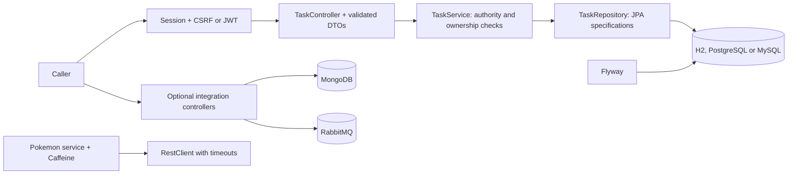
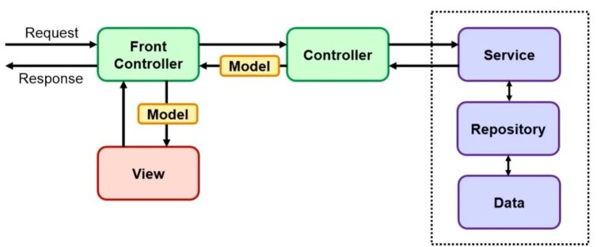
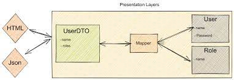
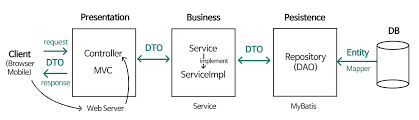

# Architecture

`task/` contains the application feature, including request/response records. Entities are not returned from the main API. Reads use read-only transactions. Updates compare the client version and use JPA optimistic locking to detect races through flush/commit. The owner is derived from authentication and never accepted from input.

List queries compose owner and status predicates in SQL so counts and page content share the same scope. Sorting includes a unique ID tie-breaker to order rows with equal titles or timestamps. This provides deterministic ordering for unchanged data; offset pagination does not provide a snapshot across concurrent changes.

`security/` contains local account authentication, password encoding, demo/bootstrap initialization, and mutually exclusive session/JWT chains. Demo initialization is opt-in by profile and idempotent. Authorities are `WRITER` and `ADMIN` without a `ROLE_` prefix.

`web/` contains the home view, session identity/CSRF endpoints, request ID propagation, and shared Problem Details. `config/` contains integration configuration, profile safeguards, and OpenAPI setup.

The `controller/`, `service/`, `repository/`, and `model/` packages contain the academic examples. Sensitive manual-auth exercises and simple JPA note controllers are only enabled by `academic`. Each JPA note example has its own table, preventing one exercise from bypassing another's controls through a shared row.

Mongo and RabbitMQ components require explicit runtime profiles. Mongo auto-configuration is excluded from the default application and enabled by the mongo profile, with repositories selected by `MongoConfig`. Rabbit listeners/topology are instantiated only with `messaging`. Test builds do not require either service.

RabbitMQ is an integration demonstration. Publishing and database writes are not an atomic transaction; the template does not claim exactly-once delivery or implement a transactional outbox. Real consumers need idempotency, retry/dead-letter policy, and operational monitoring suited to the domain.

External HTTP clients have bounded timeouts. The book service uses Spring's native HTTP interface rather than the incompatible legacy Spring Cloud Feign starter. No external HTTP request is made during normal application startup.

Testing layers include full-context MockMvc API/security tests, isolated client tests, profile checks, and Docker-backed integration tests. The test suite includes both hidden foreign-resource behavior and stale updates rather than only context loading.

The imported browser frontend lives in `src/main/resources/academic/notizen/`. `AcademicFrontendConfig` registers its resources only with the academic profile; it is not placed in the globally served static resource directory. It calls the already integrated Benutzer/token backend. It uses the same application, database, and security infrastructure as the other academic examples.

Database-specific Flyway scripts keep the same entities across engines: H2/PostgreSQL use the common migration and MySQL uses its own migration directory. `iac/` contains the build image, Compose services and local environment example.

## MVC and DTO boundaries

The controllers translate HTTP requests into service calls. Request DTOs validate incoming values; response DTOs expose the API contract without exposing persistence internals. Repository entities remain inside the main task service.

Diagram sources are listed in [the asset attribution](assets/ATTRIBUTION.md).
